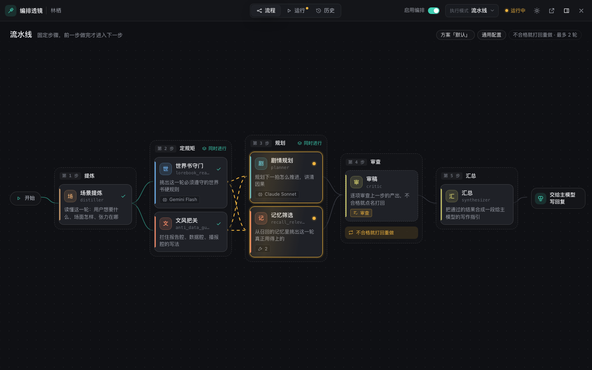
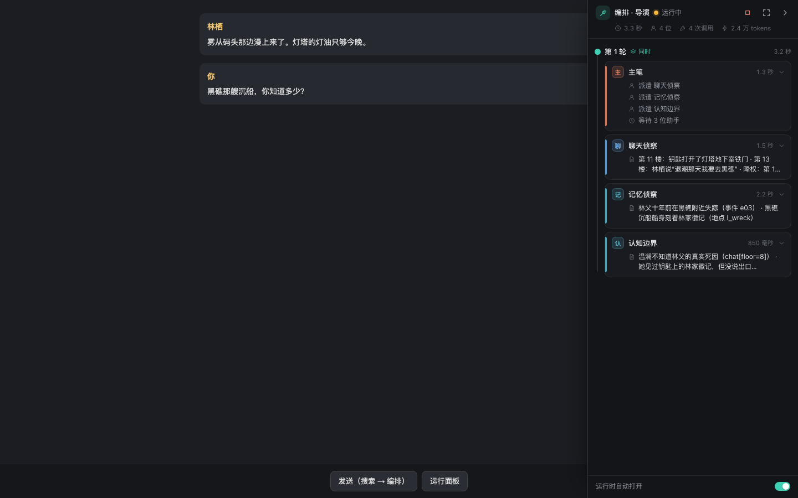
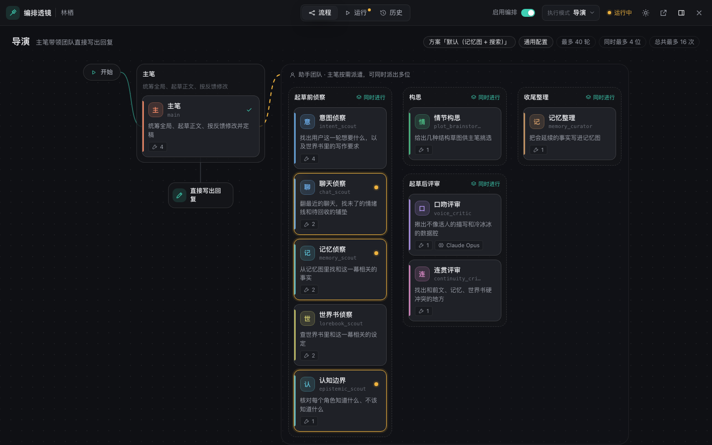
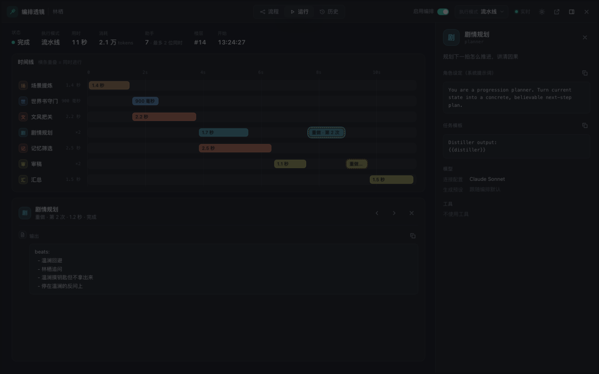
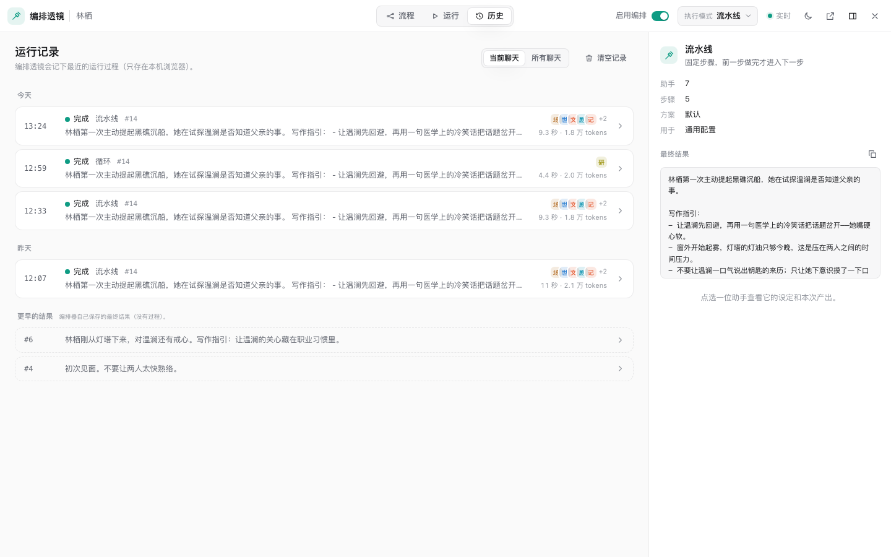

# Orchestra Lens · 编排透镜

Luker 多智能体编排（Orchestrator）的可视化工作台。从魔法棒菜单打开，全屏查看编排流程长什么样、每一轮是谁在干活、各自产出了什么。



## 功能

- **运行面板**（右侧，手机上是底部抽屉）：代替 Luker 自带的两个运行面板。回复前的联网搜索和多智能体编排都显示在这里，按步骤 / 轮次分组，每位助手一行，用一句话说明它正在做什么（「搜索网页「…」」「派遣 聊天侦察」「修改正文 2 处」），点开看完整过程。同时进行的助手一起亮起，还没轮到的步骤灰显。收起后变成右下角的小胶囊，运行结束自动消失。底部可以关掉「运行时自动打开」，或改回 Luker 自带的面板。
- **流程**：把当前方案画成从左到右的流程图。流水线、单助手、调度、循环、导演五种模式各有布局；同时进行的步骤、审查打回、交给主模型还是直接写回复，一眼能看出来。运行时卡片实时亮起（琥珀色 = 正在工作，青绿 = 完成，红 = 出错）。
- **运行**：泳道时间线，一位助手一行，横条重叠 = 同时进行；点横条看这一段的思考、输出、工具调用和调度决定。运行中可以停止。
- **历史**：自动记下最近 30 次运行的完整过程（只存在本机浏览器），按聊天筛选；更早的楼层显示编排器自己保存的最终结果。
- **详情与修改**：每位助手的职责、角色设定、任务模板、使用的连接配置 / 生成预设、可用工具。角色设定、任务模板（导演模式还有子助手说明）和两项模型选择可以直接改：改动先进草稿，顶部显示「N 处修改未保存」，保存前可逐条查看原文对比，保存后 12 秒内可撤销。如果同一处在原生面板里也改过，保存前会提示。
- **AI 助手**（顶栏「AI」）：用一句话说想怎么调，AI 读当前方案，修改各位助手的设定和模型。每轮结束列出改了哪些地方，勾选后放进草稿（也可开「自动应用」），每一轮都能撤销；保存前不会生效。对话按方案分别记录。
- **AI 诊断**：在运行页、时间线的某一段、助手详情或运行面板里点「AI 诊断」。AI 读这次运行的每一步、最终结果和主模型的回复，指出问题出在哪一步、哪位助手、为什么，并把改法作为可勾选的修改给你。可以只诊断某一步，也可以先写一句哪里不满意。
- **统计**：按本机记录的运行，列出每位助手的平均 / 最长用时、出现次数、出错率和占时比例，标出最慢和最常出错的助手。tokens 只按整次运行统计。点「AI 诊断」（或某一行右侧的靶心，只诊断这位助手），AI 会对照统计、翻出出错和最慢 / 最快的那几次过程，分清是接口问题（限流、超时、key）还是提示词 / 模型的问题，能改的直接给出修改。
- 顶栏可直接开关编排、切换执行模式，与原生面板同步。明暗主题，电脑与手机布局。
- 快捷键：`1`–`4` 切视图，`]` 开关详情栏，`Esc` 逐级退出。

AI 默认使用编排器「迭代 AI」的连接配置和生成预设，可在 AI 面板的设置里单独选。增删助手、调整步骤和工具开关仍在原生面板里做。





## 安装

1. Luker → 扩展 → 安装扩展
2. 粘贴本仓库地址
3. 刷新页面，确认已启用 **多智能体编排**
4. 魔法棒菜单 → **编排透镜**

## 截图

| 运行时间线 | 历史 |
| --- | --- |
|  |  |

截图使用的是虚构示例数据。

## 开发

```bash
npm test          # 单元测试（Node ≥ 20，无依赖）
npm run preview   # http://127.0.0.1:4174 示例数据预览；运行面板：/preview/dock.html
```

## 兼容性

读取 `extension_settings.orchestrator` 和角色卡上的编排方案；修改时按编排器自己的方式写回（通用方案写设置，角色专用方案通过编排器的 `persistOrchestratorCharacterExtension` 写进角色卡），只改动过的字段，并刷新原生编辑器的缓存，避免互相覆盖。AI 调用走 Luker 的 `iteration-library/runner.js`（与编排器自带的 AI 迭代工作室相同）；运行过程来自编排器的运行面板数据（按 URL 导入 `run-state/store.js`，与编排器共用同一个实例）。联网搜索的运行数据没有公开，透镜通过 Luker 共用的运行面板渲染器拿到它；Luker 本身的代码不做任何修改，改回原生面板后一切照旧。在 Luker 2.8.0 上验证。若 Luker 调整了模块路径，界面会提示无法读取数据而不会影响聊天。

## 许可证

[AGPL-3.0-or-later](LICENSE)。运行时会导入 Luker（AGPL-3.0）的模块。
